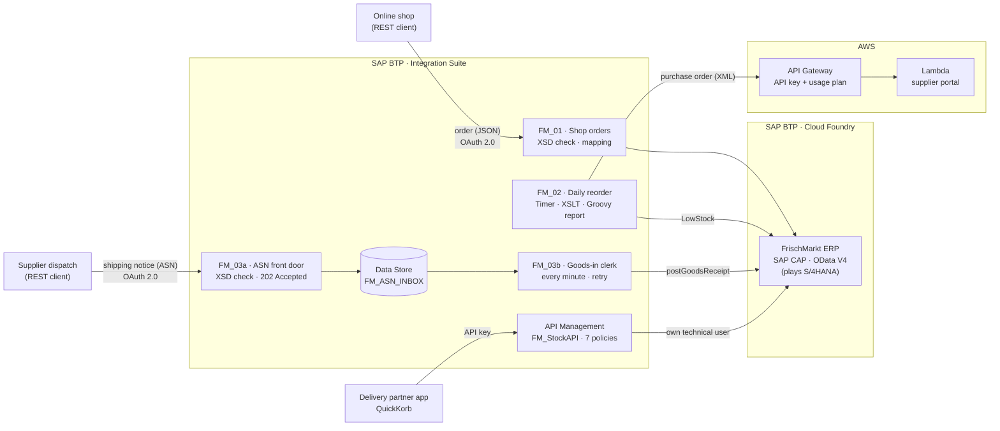

# FrischMarkt: SAP Integration Landscape of a Retail Chain

A self-built, end-to-end integration project: a fictional German supermarket chain (**FrischMarkt**) whose shops, ERP, suppliers and delivery partners are connected with **SAP Integration Suite** (Cloud Integration + API Management) on **SAP BTP**, with supplier services on **AWS**.

> **Kurzfassung (DE):** Eigenprojekt, in dem ich die Integrationslandschaft einer Supermarktkette aufgebaut habe: ein ERP-Backend mit SAP CAP (stellvertretend für S/4HANA), iFlows in SAP Cloud Integration (Bestellungen, täglicher Nachbestell-Lauf, asynchroner Wareneingang mit Retry) und eine abgesicherte Partner-API in SAP API Management. Lieferanten-Services laufen auf AWS.

---

## Architecture



## What each part shows

| Phase | Scenario | Integration patterns & skills |
|---|---|---|
| 1 | **ERP backend** with SAP CAP on Cloud Foundry, standing in for S/4HANA | OData V4 service, CDS data model, custom actions, deployment with `cf push` |
| 2 | **Shop orders → ERP** (`FM_01`) | OAuth 2.0 client credentials, XSD validation, mapping to the ERP format, synchronous error answers |
| 3 | **Daily reorder run → suppliers on AWS** (`FM_02`) | Timer start, OData query (LowStock), XSLT mapping, splitter, API key from Security Material (Groovy), per-line business result (confirmed / rejected), Groovy report stored in the Data Store |
| 4 | **Asynchronous goods receipt** (`FM_03a` + `FM_03b`) | Receive and acknowledge immediately (HTTP 202), store in a Data Store inbox, a timer-driven consumer that books into the ERP and **keeps the message until booking succeeds** (retry), idempotency in the ERP (no double booking) |
| 5 | **Partner API for a delivery app** (`FM_StockAPI`) | API Management proxy, API key per application (Developer Hub), read-only guard policy, Spike Arrest + Quota, backend login from an encrypted Key Value Map, troubleshooting with the Debug tool |

### Design decisions worth explaining
- **Asynchronous instead of synchronous (Phase 4):** the supplier gets "received" in seconds, even when the ERP is down. CPI books later and retries. (A JMS queue would be the production choice; the trial tenant has no Message Queues, so a Data Store inbox plays that role.)
- **Business error vs technical error:** a supplier's "rejected" (HTTP 422) is a valid business answer and is reported, not retried. An ERP outage is a technical error and is retried.
- **Two keys, two worlds (Phase 5):** the partner authenticates to API Management with its API key. API Management authenticates to the ERP with its own technical user from an encrypted Key Value Map. The partner never sees the backend address or credentials, and the backend never sees the partner key.

## Repository layout

```
erp/                    SAP CAP service (OData V4), the "S/4HANA" of the project
cpi/phase2-shop-orders/ XSD for shop order + ERP sales order, sample
cpi/phase3-daily-reorder/ XSLT mapping, Groovy scripts (report, API key header), samples
cpi/phase4-goods-receipt/ XSD + XSLT for the shipping notice → goods receipt
cpi/iflows/             exported iFlow packages (.zip)
aws/supplier-lambda/    Python Lambda behind API Gateway (supplier portal)
api-management/policies/ the 7 policies of FM_StockAPI, in execution order
http-tests/             REST Client test files (all secrets are placeholders)
docs/screenshots/       monitoring, trace and test screenshots
```

## Run the ERP locally

```bash
cd erp
npm install
cds watch            # http://localhost:4004
```

Demo users are defined in `erp/package.json` (mocked authentication). Set your own passwords before deploying; real values are never committed.

## Security notes
- No credentials, API keys or tenant URLs are stored in this repository. All `.http` files use placeholders.
- Secrets live in CPI Security Material, an encrypted Key Value Map (API Management) and the AWS API Gateway key store.

---
Built by **Marwan Soltan** · [LinkedIn](https://linkedin.com/in/marwan-soltan) · SAP Certified BTP Administrator · AWS Certified Solutions Architect – Associate
